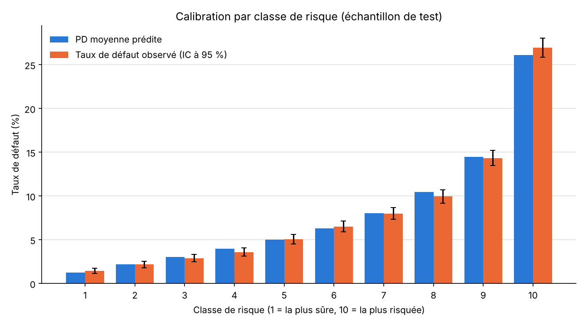
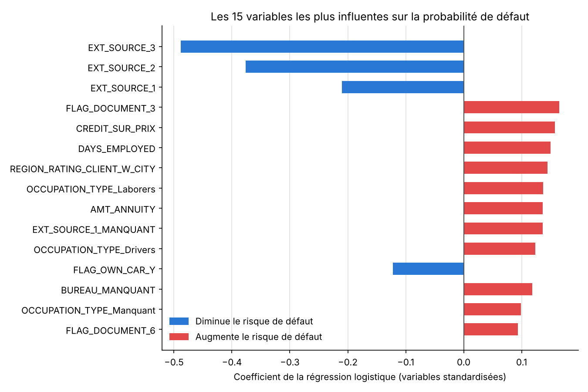

# Modèle de probabilité de défaut (PD) : Home Credit, version 1

Modèle de scoring de crédit construit de bout en bout en Python sur la table principale du jeu de données Kaggle *Home Credit Default Risk* : préparation des données sans fuite d'information, régression logistique interprétable, échelle de notation en 10 classes de risque, puis contrôles de calibration et de stabilité.

> **Statut : première version (v1).** Seule la table `application_train.csv` (le profil du client à la demande de prêt) est exploitée. Les autres tables du jeu de données (historique de crédit, demandes précédentes, remboursements) sont volontairement laissées de côté et feront l'objet d'une version 2, dont le gain sera mesuré par rapport aux chiffres ci-dessous. Les limites de cette v1 sont détaillées [plus bas](#limites-de-cette-version).

Projet personnel d'apprentissage réalisé par Florent Voisin (élève ingénieur UTBM, filière Vision artificielle et systèmes autonomes) pour découvrir la modélisation du risque de crédit. Ce n'est pas un modèle réglementaire.

---

## Résultats en un coup d'œil

Tous les chiffres sont calculés sur un échantillon de test de 61 503 clients, jamais utilisé pour entraîner le modèle.

| Indicateur | Résultat | Lecture |
|---|---|---|
| Classement des clients (régression logistique) | **AUC 0,749 · Gini 0,498** | Dans environ 75 % des paires (un client en défaut, un client sans défaut), le modèle donne la PD la plus élevée au client en défaut |
| Benchmark non linéaire (gradient boosting) | AUC 0,758 · Gini 0,516 | Un modèle plus complexe gagne 0,017 de Gini : l'avantage de la complexité est faible ici |
| Score de Brier | **0,0683** contre 0,0742 pour une PD constante | Réduction de 8 % de l'erreur quadratique par rapport à un modèle qui donne à tous les clients le taux de défaut moyen |
| Échelle de notation | Taux de défaut observé de **1,5 % (classe 1) à 26,9 % (classe 10)** | Le taux augmente à chaque classe, avec un risque environ 18 fois plus élevé en classe 10 qu'en classe 1 |
| Calibration par classe | `\|z\|` ≤ 1,54 sur les 10 classes | Aucune classe ne présente d'écart significatif (seuil 1,96) entre PD prédite et taux observé |
| Stabilité train / test | PSI = 0,00009 | Très sous le seuil usuel de 0,10, mais attendu avec un découpage aléatoire (voir les limites) |

### Calibration par classe de risque



Pour chaque classe, la barre bleue est la PD moyenne prédite par le modèle et la barre orange le taux de défaut réellement observé, avec son intervalle de confiance à 95 %. Les valeurs chiffrées sont dans le [tableau des classes](#échelle-de-notation-en-10-classes).

### Variables les plus influentes



---

## Contexte et objectif

Une banque qui accorde un crédit estime la **probabilité de défaut (PD)** de chaque emprunteur : la probabilité qu'il ne rembourse pas. Cette estimation sert à décider d'accorder ou non le prêt, à fixer son prix et à calculer les provisions pour pertes.

Deux qualités sont attendues d'un modèle de PD, et ce projet mesure les deux :

- **Le classement (ranking)** : les clients qui feront défaut doivent recevoir des PD plus élevées que les autres. Il se mesure par l'AUC et le Gini.
- **Le niveau (calibration)** : une PD de 5 % doit correspondre à environ 5 % de défauts réellement observés. Il se mesure par le score de Brier et par la comparaison, classe par classe, de la PD prédite et du taux observé.

La variable à prédire est `TARGET` (1 = défaut, 0 = pas de défaut), selon la définition propre au jeu de données Home Credit. Cette définition n'a pas été comparée à la définition réglementaire du défaut.

## Données

- **Source** : compétition Kaggle [Home Credit Default Risk](https://www.kaggle.com/competitions/home-credit-default-risk), fichier `application_train.csv`.
- **Contenu** : 307 511 demandes de prêt, une ligne par demande, avec le profil du client (revenu, montant du crédit, emploi, scores externes, informations sur le logement, etc.) et la variable `TARGET`. Le taux de défaut est de 8,07 %.
- **Les données ne sont pas incluses dans ce dépôt** : elles ne se redistribuent pas, et le fichier dépasse la limite de taille de GitHub. Voir [`data/README.md`](data/README.md) pour les télécharger.

## Organisation du projet

```
.
├── 01_preparation.py            Nettoyage, découpage train/test, encodage
├── 02_modele.py                 Régression logistique, AUC/Gini, coefficients, benchmark
├── 03_classes_risques.py        Échelle de notation en 10 classes, graphique de calibration
├── 04_calibration_stabilite.py  Score de Brier, test par classe, intervalles de confiance, PSI
├── requirements.txt             Dépendances Python
├── data/                        Données (non versionnées, voir data/README.md)
└── figures/                     Graphiques produits par les scripts
```

Les scripts se lancent dans l'ordre. Chacun lit les fichiers produits par le précédent dans `data/processed/` :

| Script | Entrée | Sortie |
|---|---|---|
| `01_preparation.py` | `data/application_train.csv` | `X_train`, `X_test`, `y_train`, `y_test`, `ids_test` (.pkl) |
| `02_modele.py` | fichiers du script 01 | `pd_train.pkl`, `pd_test.pkl`, `figures/coefficients_top15.png` |
| `03_classes_risques.py` | fichiers du script 02 | `bornes.pkl`, `classes_test.pkl`, `figures/calibration_classes.png` |
| `04_calibration_stabilite.py` | fichiers des scripts 02 et 03 | résultats affichés dans le terminal |

## Installation et exécution

Prérequis : Python 3.11 (version utilisée pour développer le projet) et un compte Kaggle pour télécharger les données.

```bash
# 1. Récupérer le projet
git clone https://github.com/Florentvsn/projet-pd-home-credit
cd projet-pd-home-credit

# 2. Créer un environnement virtuel et installer les dépendances
python -m venv venv
venv\Scripts\activate            # Windows (sous Linux / macOS : source venv/bin/activate)
pip install -r requirements.txt

# 3. Placer application_train.csv dans data/ (voir data/README.md)

# 4. Lancer les scripts dans l'ordre, depuis la racine du projet
python 01_preparation.py
python 02_modele.py
python 03_classes_risques.py     # une fenêtre de graphique s'ouvre : la fermer pour continuer
python 04_calibration_stabilite.py
```

Les scripts affichent leurs résultats et leurs contrôles dans le terminal. Les graines aléatoires sont fixées (`random_state=42`).

### Valeurs de référence pour vérifier la reproduction

| Étape | Valeur attendue |
|---|---|
| Après suppression des colonnes trop vides | 307 511 lignes, 83 colonnes |
| Découpage | 246 008 lignes (train) et 61 503 lignes (test), taux de défaut de 8,07 % dans les deux |
| Variables du modèle après encodage | 133 colonnes |
| Régression logistique | AUC 0,7492 · Gini 0,4984 |
| Gradient boosting | AUC 0,7579 · Gini 0,5157 |
| Score de Brier | 0,0683 |
| PSI | 0,00009 |

De légers écarts sont possibles selon les versions des bibliothèques installées.

---

## Démarche et choix méthodologiques

**Principe général : aucune fuite d'information.** Le découpage train / test est fait avant tout calcul de statistique. Les médianes, plafonds, listes de modalités fréquentes et paramètres de standardisation sont calculés sur le train uniquement, puis appliqués tels quels au test. Le test ne sert qu'à évaluer.

### Préparation (`01_preparation.py`)

| Choix | Justification |
|---|---|
| Découpage 80 / 20 stratifié sur `TARGET` | Le taux de défaut (8,07 %) est identique dans les deux échantillons |
| Suppression des colonnes à plus de 50 % de valeurs manquantes (sauf `OWN_CAR_AGE` et `EXT_SOURCE_1`) | Trop peu d'information exploitable ; les deux exceptions sont jugées potentiellement importantes. Limite : ce taux est calculé sur tout le fichier, avant le découpage |
| Colonnes indicatrices `BUREAU_MANQUANT` et `EXT_SOURCE_1_MANQUANT` | L'absence d'information est conservée comme variable, car elle peut être elle-même un signal |
| Remplissage des manquants : 0 pour `OWN_CAR_AGE`, modalité « Manquant » pour trois variables catégorielles, médiane du train pour les variables numériques restantes | Le modèle n'accepte pas de valeurs manquantes |
| `DAYS_EMPLOYED` : la valeur 365 243 (environ 1 000 ans) est remplacée par la médiane du train | Valeur sentinelle associée à l'absence d'emploi, qui fausserait les calculs. L'information est conservée dans `SANS_EMPLOI`, utilisée pour contrôle puis exclue du modèle car elle double `ORGANIZATION_TYPE_XNA` |
| `AMT_INCOME_TOTAL` plafonné au 99,9e percentile du train (environ 900 000) | Quelques revenus extrêmes (plusieurs millions) fausseraient les coefficients |
| Regroupement des modalités rares dans « RARE » (seuil de 1 % pour `ORGANIZATION_TYPE`, qui passe de 58 à 18 modalités ; seuil de 0,1 % pour `NAME_INCOME_TYPE` et `NAME_FAMILY_STATUS`) | Trop peu de clients pour estimer un taux de défaut fiable. Cela évite aussi qu'une modalité de quelques clients devienne la modalité de référence de l'encodage |
| Suppression de 7 colonnes `FLAG_DOCUMENT` ayant moins de 100 clients à 1 | Information quasi nulle |
| Suppression de `CODE_GENDER` | Variable sensible : la directive européenne 2004/113/CE interdit la discrimination fondée sur le sexe dans l'accès aux biens et services. Limite : d'autres variables peuvent servir de substitut (voir les limites) |
| Encodage one-hot avec `drop_first=True` ; colonnes du test alignées sur celles du train | Le modèle ne traite que des nombres ; le test doit avoir exactement les mêmes colonnes |

### Modèle (`02_modele.py`)

**Variable `CREDIT_SUR_PRIX`.** `AMT_CREDIT` et `AMT_GOODS_PRICE` sont quasi identiques (corrélation de 0,987). Avec les deux, la régression logistique leur donne des coefficients opposés et très grands (environ −1,01 et +0,91), qui compensent l'une l'autre : c'est un artefact de la colinéarité et non un effet réel, donc ils ne peuvent pas s'interpréter. Trois variantes ont été comparées sur le test :

| Variante | Colonnes | AUC |
|---|---|---|
| Avec `AMT_CREDIT` et `AMT_GOODS_PRICE` | 133 | 0,7489 |
| Sans `AMT_GOODS_PRICE` | 132 | 0,7460 |
| **Avec le ratio `CREDIT_SUR_PRIX` = crédit / prix du bien (retenue)** | 133 | **0,7492** |

Le ratio mesure la part du crédit qui ne finance pas le bien (frais, assurances, etc.). Il récupère toute la performance de la première variante avec des coefficients lisibles, et il se calcule ligne par ligne sans statistique du train.

**Standardisation.** Les variables ont des échelles très différentes (des montants de plusieurs centaines de milliers contre des indicateurs 0/1). Chaque colonne est ramenée à une moyenne de 0 et un écart-type de 1 (paramètres appris sur le train). Les coefficients deviennent comparables entre eux.

**Régression logistique retenue plutôt qu'un modèle plus complexe.** Elle donne une PD directement interprétable (chaque coefficient indique le sens et le poids d'une variable) et c'est une approche très répandue pour les modèles de crédit bancaires. Un gradient boosting (`HistGradientBoostingClassifier`, 300 arbres au plus, 15 feuilles par arbre, taux d'apprentissage de 0,05, arrêt anticipé) sert de comparaison : il gagne 0,017 de Gini, un gain qui ne justifie pas de renoncer à l'interprétabilité. Ses hyperparamètres ont été fixés a priori et non réglés.

---

## Résultats détaillés

### Interprétation des coefficients

Les coefficients sont lus « toutes choses égales par ailleurs » ; ils décrivent des associations statistiques et non des causes. Un écart-type de plus sur une variable standardisée change le score du modèle du montant du coefficient.

| Variable | Coefficient | Lecture |
|---|---|---|
| `EXT_SOURCE_3`, `EXT_SOURCE_2`, `EXT_SOURCE_1` | −0,49 ; −0,38 ; −0,21 | Scores externes normalisés fournis dans les données : plus ils sont élevés, plus le risque de défaut est faible. Ce sont les variables les plus influentes |
| `CREDIT_SUR_PRIX` | +0,16 | Plus le crédit dépasse le prix du bien, plus le risque est élevé |
| `DAYS_EMPLOYED` | +0,15 | La variable est négative (jours avant la demande) : une valeur plus élevée signifie une ancienneté plus courte, donc plus de risque |
| `REGION_RATING_CLIENT_W_CITY` | +0,14 | Note attribuée à la région du client : une valeur plus élevée va avec plus de risque |
| `OCCUPATION_TYPE_Laborers`, `OCCUPATION_TYPE_Drivers` | +0,14 ; +0,12 | Risque plus élevé que la modalité de référence |
| `AMT_ANNUITY` | +0,14 | Une annuité (montant des remboursements périodiques) plus élevée va avec plus de risque |
| `EXT_SOURCE_1_MANQUANT`, `BUREAU_MANQUANT`, `OCCUPATION_TYPE_Manquant` | +0,14 ; +0,12 ; +0,10 | L'absence d'information est elle-même associée à plus de risque |
| `FLAG_OWN_CAR_Y` | −0,12 | Posséder une voiture va avec moins de risque |
| `FLAG_DOCUMENT_3`, `FLAG_DOCUMENT_6` | +0,16 ; +0,09 | Association observée, sans interprétation proposée |

Les variables corrélées entre elles (par exemple les nombreuses colonnes décrivant le logement) peuvent se partager le poids de façon instable : seules les variables ci-dessus, dont le sens est cohérent, sont commentées.

### Échelle de notation en 10 classes

Les bornes des classes sont définies sur le train (10 groupes de même effectif, environ 24 600 clients chacun) puis appliquées au test.

| Classe | Effectif (test) | PD moyenne prédite | Taux de défaut observé | IC à 95 % | z |
|---:|---:|---:|---:|:---:|---:|
| 1 | 6 192 | 1,24 % | 1,45 % | [1,16 ; 1,75] | +1,49 |
| 2 | 6 092 | 2,20 % | 2,17 % | [1,80 ; 2,53] | −0,17 |
| 3 | 6 134 | 3,03 % | 2,90 % | [2,48 ; 3,32] | −0,58 |
| 4 | 6 249 | 3,95 % | 3,58 % | [3,12 ; 4,05] | −1,49 |
| 5 | 6 248 | 5,01 % | 5,06 % | [4,51 ; 5,60] | +0,18 |
| 6 | 6 074 | 6,29 % | 6,52 % | [5,90 ; 7,14] | +0,75 |
| 7 | 6 162 | 8,01 % | 8,00 % | [7,32 ; 8,68] | −0,03 |
| 8 | 6 098 | 10,45 % | 9,94 % | [9,19 ; 10,69] | −1,31 |
| 9 | 6 124 | 14,46 % | 14,34 % | [13,46 ; 15,21] | −0,27 |
| 10 | 6 130 | 26,09 % | 26,95 % | [25,84 ; 28,06] | +1,54 |

- **Le classement fonctionne** : le taux de défaut observé augmente à chaque classe.
- **Le niveau est correct** : la PD moyenne prédite se situe dans l'intervalle de confiance du taux observé pour les 10 classes, et aucun `|z|` ne dépasse 1,96. Le `z` compare l'écart entre taux observé et PD prédite à l'écart que le hasard suffit à produire. Avec 10 classes testées à 5 %, une classe hors seuil par pur hasard ne serait pas anormale ; ici aucune n'y est.
- **Portée de ce test** : ne pas détecter d'écart ne prouve pas l'absence d'écart. Avec environ 6 000 clients par classe, seuls les écarts importants sont détectables.

### Score de Brier

Le score de Brier est la moyenne des carrés des écarts entre la PD et le défaut réel (0 ou 1) : plus il est bas, mieux c'est. Seul, il ne se lit pas ; il se compare à celui d'un modèle sans information qui donnerait à chaque client le taux de défaut moyen *p*, dont le score vaut *p*(1 − *p*) = 0,0742. Le modèle obtient **0,0683**, soit une réduction de 8 %. Le gain est modeste, ce qui est cohérent avec un AUC de 0,75 : avec des défauts rares et difficiles à prédire, le score de Brier laisse peu de marge de progression.

### Stabilité (PSI)

Le PSI (*Population Stability Index*) compare la répartition des clients entre les 10 classes dans le train et dans le test : PSI = Σ (part_test − part_train) × ln(part_test / part_train). Seuils usuels : inférieur à 0,10, population stable ; de 0,10 à 0,25, dérive modérée ; supérieur à 0,25, dérive forte. Le résultat est de **0,00009**. Ce résultat valide le calcul et le découpage, mais il était attendu : train et test sont deux tirages aléatoires du même fichier. Il ne dit rien de la stabilité du modèle dans le temps.

---

## Limites de cette version

1. **Une seule table exploitée.** Le modèle ne voit que le profil déclaré à la demande de prêt, pas le comportement passé du client (crédits ailleurs, retards, demandes précédentes). C'est la principale marge d'amélioration.
2. **Pas de validation dans le temps.** Le jeu de données n'expose pas de dates exploitables : la stabilité n'est testée que sur un découpage aléatoire. Une validation réelle comparerait des clients de périodes différentes.
3. **Un seul découpage train / test.** Pas de validation croisée : les indicateurs sont calculés sur un seul échantillon de test, et les hyperparamètres du gradient boosting ne sont pas optimisés.
4. **Règle des 50 % de manquants** calculée sur tout le fichier avant le découpage (fuite d'information légère, sur la seule sélection des colonnes).
5. **Définition du défaut** propre au jeu de données, non comparée à la définition réglementaire.
6. **Équité.** Le genre est retiré, mais aucune analyse n'a vérifié que d'autres variables ne le remplacent pas (variables substituts).
7. **Variables corrélées** : seule la paire crédit / prix du bien a été traitée ; les autres groupes de variables corrélées n'ont pas été examinés.
8. **Pas un modèle réglementaire.** Les modèles de PD bancaires sont soumis à des exigences supplémentaires (définition réglementaire du défaut, calibration sur le cycle, marges de prudence, validation indépendante) qui ne sont pas couvertes ici.

## Pistes pour la version 2

- Agréger les autres tables du jeu de données à une ligne par client (`bureau`, `bureau_balance`, `previous_application`, `installments_payments`, `credit_card_balance`, `POS_CASH_balance`) et mesurer le gain de Gini par rapport à cette v1.
- Validation croisée stratifiée et réglage des hyperparamètres sur le train uniquement.
- Traitement des groupes de variables corrélées et régularisation.
- Comparaison avec une grille de score construite par discrétisation (WoE / IV), le format classique des scorecards.
- Analyse d'équité sur les variables pouvant servir de substitut au genre.
- Notebook de présentation des résultats.

## Glossaire

| Terme | Définition |
|---|---|
| PD | Probabilité de défaut : probabilité estimée qu'un emprunteur ne rembourse pas |
| AUC | Probabilité qu'un client en défaut tiré au hasard reçoive une PD plus élevée qu'un client sans défaut tiré au hasard (0,5 = hasard, 1 = parfait) |
| Gini | 2 × AUC − 1, la même information rééchelonnée (0 = hasard, 1 = parfait) |
| Calibration | Adéquation entre le niveau des PD prédites et les taux de défaut réellement observés |
| Score de Brier | Moyenne des carrés des écarts entre PD et défaut réel (plus bas = mieux) |
| PSI | Indicateur de dérive de la répartition d'une population entre deux échantillons |
| IC à 95 % | Intervalle dans lequel se trouve le vrai taux avec 95 % de confiance, taux observé ± 1,96 × erreur-type |
| Fuite d'information | Utiliser des données du test (même indirectement) pour construire le modèle, ce qui fausse l'évaluation |

## Licence

Code distribué sous licence MIT (voir [`LICENSE`](LICENSE)). Les données Home Credit restent soumises aux conditions de la compétition Kaggle.
